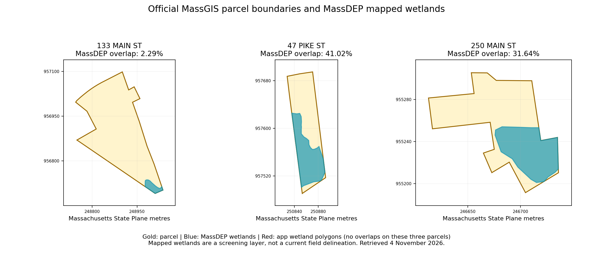

# Top ten off-market parcels: public-source verification

Audit date: 4 November 2026. This is an evidence audit of the current SiteIQ dataset, not an update to that dataset.

**Result: the ten records cannot be signed off as fully correct.** Core identities, zoning codes and the assessor-recorded transfers largely match. Material issues include wetland coverage on two highly ranked parcels, outdated Amesbury assessments, incomplete owner names, and GIS acreage presented as recorded acreage. Current mortgage status, title interests, tax balances and inheritance claims remain unverified where the supporting instruments could not be retrieved.

## Scope and method

I reproduced the application's `ranking-v5-loans` scores, including the seller-factor cap of 60, and sorted the parcels using the application’s score/address ordering. I then selected the first ten records whose listing status is **Not listed**, across **all screening results**. This includes two parcels the application already excludes for having less than one usable acre. It is not a list of ten development-approved properties.

The list has overall ranks 1–7 and 9–11: the property at overall rank 8 has a listing status and was excluded from this off-market audit. The app’s listing snapshot is dated **22 October 2026**. Scores below are the app's existing scores, not corrected or endorsed scores.

Sources checked independently:

- Current Salisbury Patriot Properties assessor cards, matched by exact parcel ID, including secondary owner lines and total-parcel values on multi-card properties. [Salisbury assessment database](https://webpro.patriotproperties.com/salisbury/home-bottom.asp).
- Amesbury Vision assessor cards, ownership history and valuation history, checked against the city’s published FY2026 address list. [Amesbury Assessor](https://www.amesburyma.gov/193/Assessor), [FY2026 values](https://www.amesburyma.gov/DocumentCenter/View/5795/2026-Values-by-Street-Address-PDF).
- Live official MassGIS parcel attributes and polygons, queried for the ten exact addresses/parcel identities. Areas were measured in Massachusetts State Plane EPSG:26986, not Web Mercator. [MassGIS parcel service](https://services1.arcgis.com/hGdibHYSPO59RG1h/ArcGIS/rest/services/Massachusetts_Property_Tax_Parcels/FeatureServer/0).
- Independent statewide MassDEP wetland polygons, intersected with both the live official parcel boundaries and the app's stored boundaries. [MassDEP wetland service](https://services1.arcgis.com/hGdibHYSPO59RG1h/ArcGIS/rest/services/MassDEP_Wetlands_Outlines_and_Labels/FeatureServer).
- Address-specific Zillow, Redfin and Realtor public pages, plus the commercial directory for 133 Main, for listing indications and historical listing events. Some search results are cached; they are not live MLS confirmation.
- Matching funeral notices where available, to check death/family statements separately from ownership and inheritance.

The registry portal returned a loading-only page, HTTP errors or redirects; its document images could not be reviewed. Browser access was also unavailable. I did not treat registry citations already inside the application as independent verification. [Southern Essex Registry search](https://www.salemdeeds.com/masearches/).

**Meaning of the findings:** “Matches” means the specified source agrees, not that title or legal development rights have been established. “Conflicting” means sources disagree and the discrepancy needs resolution. “Unverified” means evidence was insufficient; it does not mean the claim is false. A portal’s off-market label applies to that portal and its available snapshot.

## Findings at a glance

| Off-market rank | Overall rank | Parcel | App score | Main finding |
| --- | --- | --- | ---: | --- |
| 1 | 1 | 133 Main St, Salisbury · 11-13 | 85 | GIS 14.00 ac is labeled recorded; assessor 12.817 ac. Independent mapped wetlands approximately 2.29%, not 0%. Loan and estate-title claims need documents. |
| 2 | 2 | 250 Main St, Amesbury · 77-31 | 80 | Approximately 31.64% mapped wetlands, not 0%; usable acreage needs review. FY2026 assessment $640,400, not $617,000. |
| 3 | 3 | 29 Old Elm St, Salisbury · 10-143 | 75 | Linda J MacDougall is omitted from the app owner field. Family history is partly corroborated, but current inherited title is not. |
| 4 | 4 | 47 Pike St, Salisbury · 19-56 | 75 | Approximately 41.02% mapped wetlands, not 0%; stated usable acreage conflicts. Holly B Arthur is omitted. |
| 5 | 5 | 68 Pike St, Salisbury · 18-21 | 75 | Assessor 4.246 ac versus GIS approximately 4.45 ac. Historic tax-taking claim is not proof of current debt. |
| 6 | 6 | 72 Baker Rd, Salisbury · 10-213 | 75 | Assessor has Bruce and Amy Merluzzi and two residential units; app has Bruce and one unit. Amy's 2023 death/two children are corroborated. |
| 7 | 7 | 87 Monroe St, Amesbury · 43-2 | 75 | Jessica Pouliot life-estate line is omitted; FY2026 assessment $583,700, not $566,100; recorded lot 1.15 ac versus GIS approximately 1.28 ac. |
| 8 | 9 | 4 High St, Salisbury · 18-35 | 70 | Assessor owner section also names Anthony J and Patricia L D'Anna. Death year and two-child claim were not corroborated. |
| 9 | 10 | 11 Rabbit Rd, Salisbury · 10-4 | 70 | Donna L Coates omitted. App acreage agrees with assessor rounding; Zillow's larger lot figure conflicts. Already excluded by screening. |
| 10 | 11 | 14 Rocky Hill Rd, Amesbury · 79-18 | 70 | Additional co-owner line omitted; FY2026 assessment $205,600, not $199,700; recorded lot about 0.17 ac. Already excluded by screening. |

## 1. 133 Main Street, Salisbury — parcel 11-13 — score 85

**Assessor checks:** Address/parcel ID, LLC owner, mailing address, C2 zoning, $1,664,200 assessment, $10 transfer on 4 December 2006 and deed 26348/244 agree. The assessor land area is **12.817 acres**. The current GIS polygon measures approximately **14.005 acres**, supporting the origin of the app’s 14.00 figure, but not its “Recorded lot area” label. The commercial hardware/lumber use is supported; a matched business mailing address does not establish that an owner lives there. [Official assessor card, account 871](https://webpro.patriotproperties.com/salisbury/Summary.asp?AccountNumber=871).

**Environmental checks:** The independent MassDEP layer overlaps **1,299 m² / 0.321 acres**, approximately **2.29%** of the live GIS parcel. Types are deciduous wooded swamp and shallow marsh/meadow/fen; wetland object IDs 164999 and 51042. The app shows 0%, while its report's local environmental coverage is only about 77% of the parcel. This establishes a mapped-layer discrepancy, not a current field delineation. The 8.83 usable acres remain unverified. [MassDEP source layer](https://services1.arcgis.com/hGdibHYSPO59RG1h/ArcGIS/rest/services/MassDEP_Wetlands_Outlines_and_Labels/FeatureServer/0).

**Listing and family checks:** Realmo places this exact address in its off-market section; the page’s general “for sale” title must not be mistaken for a listing of this property. A matching obituary identifies Johnson Lumber’s founder Albert J Johnson, his January 2011 death and five children. That supports the biographical statement, but does not establish heirs’ ownership of land held by an LLC. [Commercial directory](https://realmo.com/retail-properties/for-sale/ma/salisbury/), [matching obituary](https://obituaries.newburyportnews.com/obituary/albert-johnson-772650351/).

**Still unverified:** The alleged estate lien release 33180/193, mortgage 33661/173, Carol A Johnson lender identity, $2 million original amount, absence of a subsequent discharge, current debt and all “none found” title claims. The $1,607,168 balance is a cached estimate. The app's 120.18% LTV equals original $2 million divided by assessed value; it is not independently verified current loan-to-market-value.

**Score check:** Site 30 + seller 55 = 85. The 40 estate points and 10 loan points are not independently validated as current parcel-specific conditions. The mapped wetland percentage alone remains below the model’s 10% deduction threshold.

## 2. 250 Main Street, Amesbury — parcel 77-31 — score 80

**Assessor checks:** Edward M Pike TR, Edward M Pike Trust co-owner line, Newburyport mailing address, 1.68 acres, R20, $1 transfer on 20 June 2005 and deed 24437/0069 are recorded. **FY2026 assessment is $640,400**; the app's $617,000 is FY2025. Current land use is predominantly residential/commercial with two assessed buildings, including a house and service shop, so the app's generic “Developable Residential Land” description is stale. Building count is not dwelling-unit count. [Official Vision card, PID 3100](https://gis.vgsi.com/amesburyma/Parcel.aspx?pid=3100).

**Environmental checks:** MassDEP shrub swamp object 109978 overlaps **2,145 m² / 0.530 acres**, about **31.64%** of the live GIS parcel. The app shows 0%. Even before subtracting structures or other constraints, the live GIS parcel minus mapped wetlands leaves only about **1.145 acres**, which conflicts with **1.54 dry usable acres**. The app's own boundary gives nearly the same result. [MassDEP source layer](https://services1.arcgis.com/hGdibHYSPO59RG1h/ArcGIS/rest/services/MassDEP_Wetlands_Outlines_and_Labels/FeatureServer/0).

**Listing checks:** Zillow shows off-market status and corroborates the $549,000 listing in August 2012 and removal in March 2015. It also reports a $100,000 April 2012 sale, absent from the current municipal ownership history. Treat that sale as a source conflict requiring a recorded instrument, not an automatic replacement for the assessor's 2005 transfer. [Zillow history](https://www.zillow.com/homedetails/250-Main-St-Amesbury-MA-01913/56906217_zpid/).

**Still unverified:** Discharge of the app's one historical mortgage; “free and clear”; 2026 Mass Electric easement 43502/143 and its effect; exact 3.8-mile owner distance; family relationship inferred from nominal consideration.

**Score check:** Site 25 + capped seller 60 − easement 5 = 80. The independent wetland finding would trigger a 10-point wetland deduction under the current model. A dry-area upper bound below 1.5 acres also places the size factor in a lower band. A scenario using those two findings alone yields **65**, not an approved replacement score; usable area and the other evidence still require validation.

## 3. 29 Old Elm Street, Salisbury — parcel 10-143 — score 75

**Assessor checks:** Address/parcel ID, C zoning, $1 transfer on 20 May 2010 and deed 29473/460 agree. The owner section includes **Glenn H and Linda J MacDougall**, while the app keeps only Glenn. Recorded land is **1.600 acres**, versus app GIS-derived 1.59. **$756,100 is the total parcel assessment**, so the lower value on the first of two cards is not an app error. Mixed commercial/residential use is supported by the house and repair-garage cards. [Official assessor card, account 764](https://webpro.patriotproperties.com/salisbury/Summary.asp?AccountNumber=764).

**Environmental/listing checks:** No positive-area overlap was found in the queried MassDEP polygon layer. This is compatible with the app’s mapped 0%, but does not prove absence of jurisdictional wetlands. The 1.24 usable acres are not externally certified. Zillow labels the address off-market; its single-family label is less complete than the municipal mixed-use record. [Zillow property page](https://www.zillow.com/homedetails/29-Old-Elm-St-Salisbury-MA-01952/56962262_zpid/).

**Family checks:** Louise A MacDougall's funeral notice states she died in April 2010, her husband Harvey L Jr died in November 2009, and surviving son Glen and his wife Linda were in Salisbury. It also names a predeceased son. Clarify surviving versus total children before approving the app's unqualified “1 child” statement about Harvey. The property link is corroborated by the assessor's MacDougall grantor, but the estate affidavits themselves were not reviewed. [Funeral-home notice](https://www.contefuneralhomes.com/obituaries/Louise-A-MacDougall?obId=9340374).

**Still unverified:** Instruments 29134/406 and 29473/460 as estate affidavits, present inheritance/title, lack of mortgages, leases, easements, tax takings or litigation. A nominal transfer plus matching family information is not a complete title review.

**Score check:** Site 20 + seller 55 = 75; 40 estate points depend on an instrument claim not independently inspected.

## 4. 47 Pike Street, Salisbury — parcel 19-56 — score 75

**Assessor checks:** R2, $728,800 assessment, $84,000 transfer on 21 October 1994 and deed 12791/402 agree. Owner section includes **Marc J Janvrin and Holly B Arthur**, while the app omits Holly. Recorded lot is **1.959 acres**; app 2.00 is approximately the GIS polygon measurement, not the assessor acreage. Single-family residential use and one residential unit are supported. [Official assessor card, account 1821](https://webpro.patriotproperties.com/salisbury/Summary.asp?AccountNumber=1821).

**Environmental checks:** MassDEP deciduous wooded swamp object 174419 overlaps **3,329 m² / 0.823 acres**, about **41.02%** of the live GIS parcel. The app’s boundary gives approximately 41.16%, confirming this is not a small boundary-alignment effect. The app shows 0% and **1.81 usable acres**. Live GIS land minus mapped wetlands is only about **1.183 acres**, before excluding structures, buffers or access constraints. [MassDEP source layer](https://services1.arcgis.com/hGdibHYSPO59RG1h/ArcGIS/rest/services/MassDEP_Wetlands_Outlines_and_Labels/FeatureServer/0).

**Listing checks:** Zillow's off-market label and historical 2009–2011 listings, price reductions and two removals agree with the app's listing history. Old marketing language about a “level lot” does not override the mapped wetland finding. [Zillow history](https://www.zillow.com/homedetails/47-Pike-St-Salisbury-MA-01952/56962960_zpid/).

**Still unverified:** Seven mortgage discharges, lack of subsequent loans or restrictions, current tax balance, and whether all past listings concern the same legal land now being evaluated. Long ownership does not independently establish the owner's age or willingness to sell.

**Score check:** Site 20 + seller 55 = 75. A scenario applying only the independent wetland band and a dry-area size band below 1.5 acres gives **60**. This is a sensitivity calculation, not an implemented score or a buildability conclusion.

## 5. 68 Pike Street, Salisbury — parcel 18-21 — score 75

**Assessor checks:** Suzanne Wilmot Perron, mailing address, LM zoning, $579,300 assessment, $1 transfer on 25 September 2002 and deed 19286/93 agree. The assessor lists **4.246 acres**, versus app 4.45; live GIS measures approximately **4.449 acres**. The house is classified single-family, one residential unit. LM zoning and residential existing use can coexist; the app's “Commercial” category is a screening grouping rather than proof of current commercial occupancy. [Official assessor card, account 1586](https://webpro.patriotproperties.com/salisbury/Summary.asp?AccountNumber=1586).

**Environmental/listing checks:** No positive-area MassDEP polygon overlap was found. App 4.35 usable acres are plausible only as a GIS-derived measure and exceed assessor-recorded lot area; the two measurement bases must be kept separate. Realtor's street directory identifies this address off-market, but that directory is a dated public indicator. [Realtor directory](https://www.realtor.com/local/property-records/massachusetts/essex-county/01952/pike-st).

**Still unverified:** The two alleged tax takings, latest November 2022 amount $1,976.57 and instrument 41284/349; any redemption; current unpaid balance; and lack of mortgages/restrictions. The app itself says current tax status is not confirmed. That qualification must remain visible.

**Score check:** Site 30 + seller 45 = 75. The historic tax signal contributes 20 points; those points are provisional pending the instrument and redemption check. A $1 deed alone does not prove a family relationship.

## 6. 72 Baker Road, Salisbury — parcel 10-213 — score 75

**Assessor checks:** R2, $768,300 assessment, $20,000 transfer on 28 June 1985 and deed 7810/228 agree. Current assessor owner lines include **Bruce and Amy Merluzzi**, while the app lists Bruce only. The card explicitly describes a single-family house with accessory apartment and **two residential units**; the app says one. MassGIS also reports two units. Recorded land is **1.160 acres**, versus app 1.17, a small GIS/recorded difference. [Official assessor card, account 827](https://webpro.patriotproperties.com/salisbury/Summary.asp?AccountNumber=827).

**Environmental/listing checks:** No positive-area overlap was found in the queried MassDEP layer. App 1.06 usable acres remain an unverified derived figure. Realtor's Baker Road directory identifies 72 Baker as off-market. [Realtor directory](https://www.realtor.com/local/property-records/massachusetts/essex-county/01952/baker-rd).

**Family checks:** A matching published obituary corroborates Amy Lynn Merluzzi's November 2023 death, husband Bruce and two children. An assessor's continued inclusion of Amy is a record-state observation; it does not resolve the current legal vesting after death. [Matching obituary](https://obituaries.newburyportnews.com/obituary/amy-merluzzi-1089164560).

**Still unverified:** 2024 affidavit 42099/035, the effect on this parcel's title, five claimed mortgage discharges, current debt and absence of encumbrances or unpaid taxes.

**Score check:** Site 15 + capped seller 60 = 75. Estate 40 plus tenure 25 is capped at 60, so the individual factor values cannot simply be added without the cap.

## 7. 87 Monroe Street, Amesbury — parcel 43-2 — score 75

**Assessor checks:** Raymond and Arline Pouliot, Amesbury mailing address, I zoning and single-family use agree. The record additionally names **Jessica Pouliot (life estate)**, omitted by the app. FY2026 assessment is **$583,700**, versus app FY2025 $566,100. Recorded land is **1.15 acres**, versus GIS approximately 1.284; app usable 1.22 exceeds the recorded acreage and needs an explicit measurement basis. The July 2012 $1 transfer/deed 31499/0089 is confirmed. The card separately records a June 2012 $260,000 transfer to 87 Monroe Street Realty Trust. [Official Vision card, PID 3564](https://gis.vgsi.com/amesburyma/Parcel.aspx?pid=3564).

**Environmental/listing checks:** No positive-area MassDEP polygon overlap was found. Redfin labels the property off-market and shows the earlier 2012 market sale. That sale and the subsequent $1 transfer are different transactions, not evidence the app's July transfer is false. Industrial zoning does not make this existing house an operating industrial business. [Redfin page](https://www.redfin.com/MA/Amesbury/87-Monroe-St-01913/home/8200855).

**Still unverified:** A matching 2023 death and three children for the app's Raymond E Pouliot; lien release 42587/508; identity linkage between that estate and the current owners; current loan status; and absence of restrictions. Search results for other Raymond Pouliots were rejected rather than treated as matches. The assessor's life-estate line is real source evidence but is not a substitute for the deed.

**Score check:** Site 20 + seller 55 = 75. The app awards 40 estate points; its specific death/estate claim was not corroborated in this audit. A separately documented life-estate interest should not automatically be treated as the same fact.

## 8. 4 High Street, Salisbury — parcel 18-35 — score 70

**Assessor checks:** R2, $402,000 assessment, $100 transfer on 1 August 2013 and deed 32711/128 agree. In addition to Jane A MacDonald, the owner section names **Anthony J D'Anna and Patricia L D'Anna**, omitted from the app. Recorded land is **1.500 acres**, versus app GIS-derived 1.46. One residential unit and existing single-family use are supported. Exact interests must be read from the deed. [Official assessor card, account 1599](https://webpro.patriotproperties.com/salisbury/Summary.asp?AccountNumber=1599).

**Environmental/listing checks:** No positive-area overlap was found in the independent statewide MassDEP polygons. The app’s own report layers cover only approximately **67%** of its parcel, so its local layer alone cannot support a full-parcel absence claim. Redfin labels the property off-market and shows a 1.5-acre lot. The 1.35 usable acres remain unverified. [Redfin property page](https://www.redfin.com/MA/Salisbury/4-High-St-01952/home/8367933).

**Still unverified:** Jane A MacDonald's alleged 2022 death and two children; 2026 affidavit 43386/077; current inheritance/title; no mortgage, unpaid tax, easement, lease or litigation. Similar-name notices in other towns/years were not accepted as matches.

**Score check:** Site 15 + seller 55 = 70. The 40 estate points require documentary support before this score can be described as verified.

## 9. 11 Rabbit Road, Salisbury — parcel 10-4 — score 70

**Assessor checks:** C4, $577,600 total-parcel assessment, $44,000 transfer on 2 November 1984 and deed 7568/519 agree. The owner lines name **Harold N and Donna L Coates**, versus Harold alone in the app. Recorded lot **0.396 acres** rounds to app 0.40. This is a multi-card parcel; first-card value $500,000 must not be confused with the total. A residential building exists. [Official assessor card, account 641](https://webpro.patriotproperties.com/salisbury/Summary.asp?AccountNumber=641).

**Environmental/listing checks:** No positive-area MassDEP polygon overlap was found. Zillow labels the property off-market and confirms a $290,000 listing in May 2010, price reductions and removal at $245,000 in May 2011. Its 0.57-acre lot, “VacantLand” label and older sale entry conflict with the municipal parcel card; do not replace current municipal facts with those aggregator fields. [Zillow page and history](https://www.zillow.com/homedetails/11-Rabbit-Rd-Salisbury-MA-01952/56962210_zpid/).

**Still unverified:** Two mortgage discharges, no subsequent mortgages, no title restrictions, current tax balance and the claimed usable area of 0.29 acres. However, both recorded and GIS total area are below one acre, so the app's separate minimum-size exclusion is consistent with the checked area data.

**Score check:** Site 10 + seller 60 = 70. **Excluded by screening**; high seller/listing points do not make the parcel qualified.

## 10. 14 Rocky Hill Road, Amesbury — parcel 79-18 — score 70

**Assessor checks:** R20, New Harbor, Maine mailing address, vacant-land classification, $5,000 transfer on 12 February 1981 and deed 06791/0591 agree. The owner record includes the additional line **D E Barron–J Hinckley–E G W**, absent from the app; preserve the source abbreviation pending the deed. FY2026 assessment is **$205,600**, not app FY2025 $199,700. Recorded size is approximately **0.17 acres**, versus GIS approximately 0.148/app 0.15. The assessor shows zero improvements/living area; a source “units 1” field should not imply one dwelling. [Official Vision card, PID 3015](https://gis.vgsi.com/amesburyma/Parcel.aspx?pid=3015).

**Environmental/listing checks:** No positive-area MassDEP polygon overlap was found. Realtor labels the property off-market, land, last sold for $5,000 in 1981, with about a 0.17-acre lot. Its automated value estimate is not an assessed value or a sale price. [Realtor property page](https://www.realtor.com/realestateandhomes-detail/14-Rocky-Hill-Rd_Amesbury_MA_01913_M41622-47804).

**Still unverified:** The 2014 tax taking for $1,975.19, instrument 33726/308, redemption/current debt, absence of mortgages/restrictions and exact 100.5-mile distance. The mailing state supports “out-of-state mailing address,” not proof of where each co-owner currently resides. An assessor's developable-land class is not approval for a house on this small lot.

**Score check:** Site 10 + seller 60 = 70, including 20 provisional historic-tax points and 15 mailing-distance points. **Excluded by screening** for less than one usable acre.

## Checks that apply to every record

| Field or claim | Audit conclusion |
| --- | --- |
| Town, state, street address, parcel ID | All ten matched to municipal records and the official GIS identity. Exact parcel matching prevented prefix matches such as 18-21 versus 18-211. |
| Last transfer date, consideration and deed reference | All ten app entries agree with the current assessor cards. This verifies what the assessor records; underlying deeds were not inspected. Zillow's 250 Main sale conflict remains open. |
| Ownership completeness | Additional individual/co-owner lines are omitted on seven parcels. 250 Main also has an explicit trust co-owner description. Assessor owner lists are not a complete title opinion. |
| Zoning | All ten codes agree with municipal cards and/or the official GIS source. Zone boundaries, overlays, special permits and dimensional compliance were not certified. |
| Assessed values | Seven Salisbury values agree; all three Amesbury values match the cards' FY2025 history, rather than current FY2026. The statewide GIS feed still carries these older Amesbury amounts despite an FY2026 field, so that field alone is not reliable freshness evidence. |
| GIS versus recorded acreage | The app's acreage broadly follows GIS polygons. It is not interchangeable with assessor land area, deed acreage or survey area. Tiny polygon differences also exist between the stored and live GIS boundaries. |
| Usable/dry/open acreage | No independent source certified any of the ten usable-acre values. MassDEP overlap directly challenges 250 Main and 47 Pike. Paving, setbacks, wetland buffers, access and other constraints were not fully measured. |
| Wetland 0% | Three contradictions found in the independent MassDEP layer: 133 Main 2.29%, 250 Main 31.64%, 47 Pike 41.02%. The other seven have no positive-area overlap in this particular layer; that is not a field delineation or proof that all wetland constraints are absent. |
| Development status, land category and screening | These are application classifications. Existing houses can occupy parcels classified commercial/industrial by zoning. “Mixed” or “Developable” does not establish subdivision or building rights. Two of the ten are already excluded. |
| Owner type | Company/trust/individual labels are consistent with the recorded name forms. Beneficial ownership, trustee authority and current ownership interests were not established. |
| Owner lives on lot | Mailing-address equality is not independent occupancy evidence, especially for the LLC at 133 Main. The UI currently says “Owner lives on parcel,” which is stronger than the checked evidence. |
| Owner distance | Mailing towns/states match the cards. Exact distance values were not independently geocoded/routed. They measure a mailing-address relationship, not necessarily a person's residence. |
| Years owned | Broad tenure bands agree with the assessor-recorded last transfers. Values are static source numbers; they are not proof of uninterrupted beneficial ownership or age. |
| Family transfer | Nominal consideration is corroborated, but $1/$10/$100 alone does not establish kinship or the transfer's legal purpose. Matching obituaries support family links for some records, without proving current title. |
| Estate, children and heirs | Death/family evidence was corroborated for Johnson, Merluzzi and the MacDougall family. Pouliot and MacDonald claims remain unverified. Children named in an obituary are not necessarily the legal owners or heirs of this parcel. |
| Open loans and historical discharge counts | Not independently verified for any parcel because the underlying instruments and later releases could not be reviewed. “No mortgage found” is not proof of debt-free title. |
| Loan balance, equity and LTV | Model/workbook estimates, not lender balances or market appraisals. Original loan amount divided by assessed value is not current LTV. |
| Historic tax takings/current debt | The two positive historic-tax claims remain unverified; current balances/redemptions are not established. A historic taking is not evidence of present unpaid tax. Absence claims on the other eight are also unverified. |
| Leases, easements, restrictions, litigation | The 250 Main easement and other absence claims need instrument searches. The score model records no lis-pendens search for these ten; zero deduction does not establish a clean search. |
| Road and distance to road | These are app GIS/corridor fields. A nearest study-road distance does not establish legal frontage, an entrance or a highway-exit driving distance. No independent access/routing verification was completed. |
| Percentage within the 250 m corridor | A derived map metric, not a municipal property attribute; boundary/overlay comparison supports its general origin. It is not coverage of every environmental dataset. |
| Industry nearby | Computed from centroids of corridor parcels categorized industrial. It does not count verified operating industrial businesses or all nearby parcels. Example: 87 Monroe has industrial zoning and an existing house. |
| Listing status | Public pages support off-market indications for all ten, with weaker directory-only evidence for some. No live MLS feed, broker confirmation or private-sale information was available. |
| Old withdrawn listings | Specific events corroborated for 250 Main, 47 Pike and 11 Rabbit. “Removed” does not by itself prove no subsequent sale, nor does “no history” prove there never was a listing. |
| Scores | Arithmetic reproduces the app. Source correctness and score arithmetic are separate. The unresolved high-weight estate, tax, loan and usable-area inputs prevent approval of the current ranking as verified. |

## Reproducible wetland comparison

The check used the official MassGIS tax-parcel polygons and the MassDEP polygon layer, unioning wetland geometries to prevent double counting. Projection: EPSG:26986. Conversion: 4,046.8564224 m² per acre. The query retrieved 125 nearby wetland polygons without a transfer-limit truncation. Overlaps were checked again with the app’s own parcel boundaries.

| Parcel | App wetland % | Live parcel + MassDEP % | App parcel + MassDEP % | MassDEP feature IDs |
| --- | ---: | ---: | ---: | --- |
| 133 Main | 0 | 2.292 | 2.291 | 164999, 51042 |
| 250 Main | 0 | 31.637 | 31.655 | 109978 |
| 47 Pike | 0 | 41.025 | 41.160 | 174419 |
| Other seven | 0 | 0 positive-area overlap | No contradictory positive overlap identified | — |

These are calculations from the [official parcel polygons](https://services1.arcgis.com/hGdibHYSPO59RG1h/ArcGIS/rest/services/Massachusetts_Property_Tax_Parcels/FeatureServer/0) and [official wetland polygons](https://services1.arcgis.com/hGdibHYSPO59RG1h/ArcGIS/rest/services/MassDEP_Wetlands_Outlines_and_Labels/FeatureServer/0), not percentages copied from a listing site. The layer is a mapped screening resource based on historical source imagery, with varying source scales. It is not a current field survey. [MassDEP mapping description](https://www.mass.gov/info-details/massgis-data-massdep-wetlands-2005).

## Required follow-up before approving reports or changing rank

1. Reconcile the independent wetland evidence for 47 Pike, 250 Main and 133 Main; correct the chosen layer/percentage provenance, then recalculate dry usable area and score bands. Keep historical mapped evidence separate from field-confirmed wetlands.
2. Separate GIS area from assessor-recorded area; carry both with their source dates. Do not simply replace GIS geometry with a different acreage number.
3. Refresh the three Amesbury assessments and the missing owner/co-owner lines. Resolve the units/use descriptions at 72 Baker, 250 Main and the vacant lot at 14 Rocky Hill without confusing buildings with residential units.
4. Review the cited registry instruments, subsequent releases, life-estate interests and current tax/redemption records. Resolve the uncorroborated Pouliot/MacDonald estate claims and the Zillow sale conflict at 250 Main.
5. Replace occupancy, age, heirs, free-and-clear and buildability assertions with the narrower evidence actually available. Retain visible “unverified” status where documents are missing.
6. Refresh listing status from an appropriate current source before circulation, then rerun the ranking using the corrected and dated inputs.

No production parcel, score or application code was changed by this audit, and no deployment or push was performed. The linked evidence summary and map are audit artifacts. Public-source limitations above remain open; this report does not certify title, current debt, permitting or market availability.
